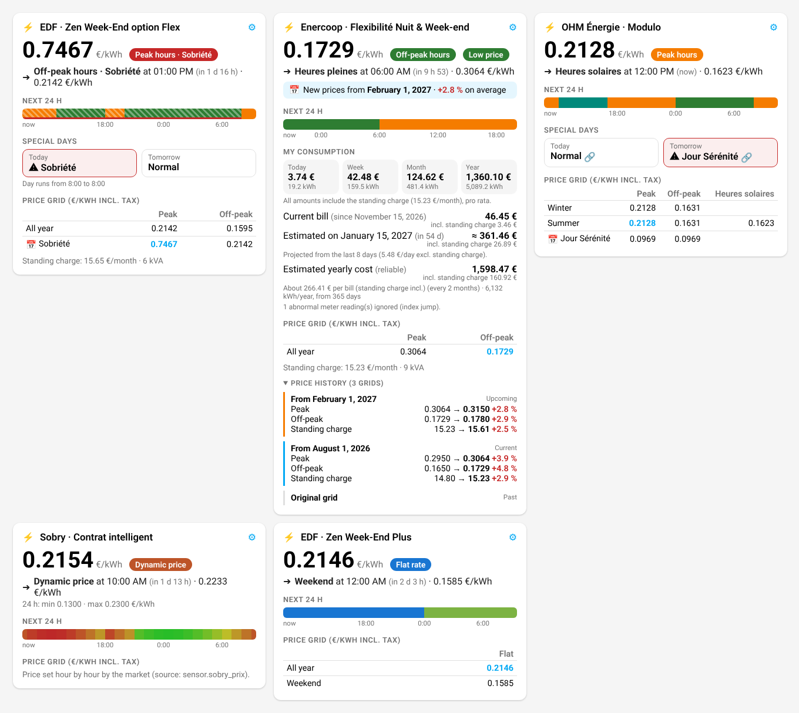

# Tarifs Électricité for Home Assistant

[🇫🇷 Français](README.md) · 🇬🇧 English

[](https://hacs.xyz)
[](https://github.com/JVmaisGpeur/ha-tarifs-electricite/releases)
[](https://github.com/JVmaisGpeur/ha-tarifs-electricite/actions/workflows/validate.yml)
[](LICENSE)


Your electricity contract in Home Assistant, **whatever your supplier**. Built for French offers (EDF, TotalEnergies, Enercoop, Octopus, OHM…): pick your offer from the list (or describe it), copy the prices from your bill, and the integration keeps track of the **current price per kWh**, the **rate period** (peak, off-peak, super off-peak, weekend…), **special days** (Tempo, Sobriété, Jour Éclair…) and **upcoming prices**. Everything is available as sensors for the Energy dashboard, automations, cards and other integrations (see [Interface for other integrations](#interface-for-other-integrations)).

A Lovelace card is included and installed automatically. The integration and the card are available in **English and French** and follow your Home Assistant language.



## Installation

Home Assistant 2025.1 or later (2026.3 or later to see the integration icon).

[](https://my.home-assistant.io/redirect/hacs_repository/?owner=JVmaisGpeur&repository=ha-tarifs-electricite&category=integration)

1. Click the button above, or: HACS → ⋮ → **Custom repositories** → `https://github.com/JVmaisGpeur/ha-tarifs-electricite`, type **Integration**.
2. Download **Tarifs Électricité**, then restart Home Assistant.
3. Settings → Devices & services → **Add integration** → *Tarifs Électricité* (or [](https://my.home-assistant.io/redirect/config_flow_start/?domain=tarifs_electricite)).
4. Pick your offer from the list, check the pre-filled structure and enter your prices.
5. Add the *Tarifs Électricité* card to a dashboard.

To change prices or offer later: the integration's **Configure** button, or the card's cog icon (see below). Subscribed power can be changed on its own through **Configure → Subscribed power**.

### Manual installation

Copy the `custom_components/tarifs_electricite` folder into your configuration's `custom_components` folder, then restart Home Assistant.

## My consumption: costs, bills, balance

Optional, at the end of the setup (or later: **Configure → Consumption tracking and bills**). Pick the **grid import energy meter** — the one used by the Energy dashboard (Linky through TIC, Shelly EM, Enphase “lifetime net energy consumption”…). History already recorded by Home Assistant is used right away.

Then tell how you pay:

- **Instalments** (fixed monthly payment + balancing bill): instalment amount, payments per year, date of the last balancing bill → suggested instalment, difference, balance.
- **Actual consumption** (bill every 1, 2, 3, 6 or 12 months, no instalments): frequency and the date of one of your bills to align periods → **current bill**, **estimated amount of the next bill** and its date (`sensor.tarif_electricite_facture_en_cours`, `_facture_estimee`, `_prochaine_facture`).

In both cases: `sensor.tarif_electricite_cout_annuel_estime` (estimated yearly cost). **Abnormal meter jumps** (a gateway that restarts and briefly reports 0, which Home Assistant takes for thousands of kWh) are detected and corrected: one hour cannot exceed the subscribed power + 25 %.

| What you get | How it is calculated |
|---|---|
| **Cost today, this week, this month, this year** (`sensor.tarif_electricite_cout_*`) | hourly consumption × that hour's price (peak/off-peak, weekend, Tempo, special days…), + the standing charge share. Attributes: kWh, energy cost, standing charge, average price paid |
| **Estimated instalment** (`sensor.tarif_electricite_mensualite_estimee`) | your last 12 months of consumption at your most recent grid's prices (upcoming change included), + 12 months of standing charge, divided by the number of payments (10, 11 or 12). Attributes: yearly consumption, yearly cost, peak/off-peak split in %, **reliability** |
| **Difference with the supplier's instalment** (`sensor.tarif_electricite_ecart_mensualite`) | estimated − charged. Positive: expect a balancing bill; negative: you pay too much. The card gives plain advice (“you can ask to lower your instalment by about 25 €/month”) |
| **Balance since the last bill** (`sensor.tarif_electricite_solde_estime`) | instalments paid (pro rata) − cost actually used since the period start. Positive: a refund is likely |

**Estimate reliability**: *reliable* with a full year of data; *fair* between 3 and 11 months, *low* under 3 months (consumption is extrapolated to a year, ignoring seasons: heating, air conditioning…); no estimate under 14 days.

Past hours are priced from the history of the *Current price* sensor (exactly what was displayed, dynamic prices and special days included). Hours before the integration was installed are recalculated from the entered grids, the Tempo colour history and the special-day log.

## Price changes and price history

When your supplier announces new prices (usually a month ahead), open **Configure**, enter the new prices, then choose:

- **Price change** + the announced effective date: the integration keeps the current prices, then **switches on its own at midnight on that day**. Meanwhile the card shows “New prices from 1 February 2027 · +2.8 % on average”.
- **Correction**: to fix a typo, without creating history.

Each grid is kept with its effective date. The card shows the history (old → new price, in %, standing charge included), and the `historique_prix` attribute of `sensor.tarif_electricite_prix_actuel` makes it available to your own cards or automations. A cancelled or duplicate change is removed with **Configure → Delete a grid**.

Forecasts and the `previsions` service take upcoming changes into account: the cheapest slot computed the day before an increase already uses the right prices.

## Ready-made offers

The template pre-fills the offer's **structure** (known time ranges, weekends, special days, seasons). **Prices are never pre-filled**: they change often, so copy them from your bill or the supplier's price grid. Always check the proposed structure.

| Template | Pre-filled |
|---|---|
| EDF Tempo | Tempo type, off-peak 22:00–6:00, automatic colours |
| EDF Zen Week-End / Zen Week-End Plus | weekend and bank holiday price (+ one chosen weekday for Plus) |
| EDF Zen Week-End Heures Creuses | peak/off-peak + weekend price |
| EDF Zen Week-End option Flex | off-peak 13:00–18:00 and 20:00–8:00, **Sobriété** days (day runs 8:00 to 8:00) |
| Enercoop Flexibilité Nuit & Week-end | off-peak 23:00–6:00, weekends and bank holidays off-peak |
| TotalEnergies Charge'Heures | peak/off-peak + super off-peak hours to enter |
| TotalEnergies Heures Eco+ | peak/off-peak + **Jours Éclair** |
| Octopus Go | peak/off-peak (night off-peak hours to enter) |
| OHM Énergie Week-End / Modulo / Beaux Jours | off-peak weekends / solar hours + seasons + Jours Sérénité / flat rate with summer price |
| Sobry, Frank Énergie | dynamic price read from another entity |
| **Other offer** | you describe everything yourself |

## Everything you can describe

| Need | Where |
|---|---|
| Single price | **Flat rate** type |
| Peak / off-peak, several ranges (`02:00-07:00, 13:00-16:00`) | **Peak / off-peak** type |
| Super off-peak hours | peak/off-peak, optional fields |
| An extra named period (“solar hours”…), off-peak or not | peak/off-peak, optional fields |
| Weekend: same as weekdays, all off-peak, or **dedicated weekend price** (with or without weekend off-peak price) | *Calendar* step |
| Bank holidays: same as weekdays, all off-peak, or same as weekends (French holidays computed automatically, Alsace-Moselle optional) | *Calendar* step |
| Weekdays at the weekend rate (Monday, Wednesday…) | *Calendar* step |
| Different winter / summer prices (and ranges), months of your choice | *Calendar* → *Summer* step |
| 1 or 2 kinds of **special days** (Sobriété, Éclair, Sérénité…), with day start hour | *Calendar* → *Special days* step |
| Tempo | **Tempo** type: colours and 15-day forecasts fetched automatically ([calendrier-tempo.fr](https://www.calendrier-tempo.fr/domotique), no account) |
| Price changing every hour | **Dynamic price** type: pick the entity giving the price (Sobry integration, EPEX Spot, Nord Pool…). €/MWh and c€/kWh converted automatically, optional surcharge (taxes, grid fees). If the entity publishes upcoming prices, they are used for forecasts |

### Special days: how does the integration know?

Suppliers announce these days the day before (email, text message or app), with no public API. Two ways:

- **With a tap**: on the card, tap *Today* or *Tomorrow* to switch from “Normal” to “Sobriété”. These are also the `select.tarif_electricite_jour_special_aujourdhui` / `_demain` entities, usable in automations. At the day start hour, “tomorrow” becomes “today”.
- **Automatically**: if another integration already announces these days (e.g. the EDF Zen Flex integration), pick its entity as the source and enter the state meaning “special day” (e.g. `Sobriété`; case and accents ignored). The card then shows 🔗.

## Entities

Entity IDs are the same on every installation, whatever the language (only the displayed names are translated):

| Entity | Content |
|---|---|
| `sensor.tarif_electricite_offre` | offer type: `base`, `hphc`, `tempo` or `dynamique`. Attributes: `fournisseur` (supplier), `nom_offre` (offer name) |
| `sensor.tarif_electricite_puissance_souscrite` | subscribed power in kVA (`unknown` if not set) |
| `sensor.tarif_electricite_prix_actuel` | current price (EUR/kWh). Attributes: period, label, special day, next change, 24 h min/max, grid, `previsions` (next 48 h slots) |
| `sensor.tarif_electricite_periode` | `hp` (peak), `hc` (off-peak), `hsc` (super off-peak), `perso` (named period), `we`, `we_hc` (weekend), `base` (flat) or `dyn` (dynamic) |
| `sensor.tarif_electricite_prochain_changement` / `_prochain_prix` | when the price changes, and the next price (`unknown` if it never changes, e.g. flat rate with no option) |
| `binary_sensor.tarif_electricite_heures_creuses` | `on` during off-peak, super off-peak, weekend off-peak, and the named period if declared off-peak |
| `binary_sensor.tarif_electricite_heures_super_creuses` | if the offer has them |
| `binary_sensor.tarif_electricite_prix_bas` | `on` when the price is in the cheapest third of the next 24 h — **works with every offer**, dynamic prices included |
| `binary_sensor.tarif_electricite_jour_special` | `on` during a special day |
| `select.tarif_electricite_jour_special_aujourdhui` / `_demain` | kind of day (offers with special days) |
| `sensor.tarif_electricite_abonnement_mensuel` | monthly standing charge, if set |
| `sensor.tarif_electricite_tempo_aujourdhui` / `_demain` / `_previsions` | Tempo offers |

**Energy dashboard**: Settings → Dashboards → Energy → grid consumption → *Use an entity with current price* → `sensor.tarif_electricite_prix_actuel`.

## `tarifs_electricite.previsions` service

Returns upcoming price slots, the cheapest and most expensive one and, if `duree` is given, **the cheapest continuous slot** of that duration.

```yaml
action: tarifs_electricite.previsions
data:
  heures: 24   # hours ahead
  duree: 3     # slot length in hours
response_variable: tarifs
# tarifs.meilleur_creneau → {debut, fin, prix_moyen}
```

## Automation examples

Turn the water heater on when the price is low (every offer):

```yaml
alias: Water heater – on when price is low
triggers:
  - trigger: state
    entity_id: binary_sensor.tarif_electricite_prix_bas
    to: "on"
actions:
  - action: switch.turn_on
    target:
      entity_id: switch.water_heater   # adapt to your entity
```

Schedule a 3-hour charge at the cheapest time of the next 24 hours:

```yaml
alias: Charging – schedule at the cheapest time
triggers:
  - trigger: time
    at: "18:00:00"
actions:
  - action: tarifs_electricite.previsions
    data: { heures: 24, duree: 3 }
    response_variable: tarifs
  - action: input_datetime.set_datetime
    target: { entity_id: input_datetime.charging_start }
    data:
      datetime: "{{ tarifs.meilleur_creneau.debut }}"
```

Get notified of a special day tomorrow:

```yaml
triggers:
  - trigger: state
    entity_id: select.tarif_electricite_jour_special_demain
condition: "{{ trigger.to_state.state != 'Normal' }}"
actions:
  - action: notify.notify
    data:
      message: "Tomorrow: {{ trigger.to_state.state }}. Consider shifting your consumption."
```

## Interface for other integrations

Other integrations may rely on Tarifs Électricité, for example to drive storage batteries or EV charging from upcoming prices. They must use **only** the entities and the service described here, never the internal code.

**Interface version: 1** (since 1.1.0), returned by the service as `version_interface`.

### Finding entities

Through Home Assistant's entity registry, using the contract's `entry_id` and the `translation_key` below — **not** the `entity_id`, which users may rename. `unique_id` is `<entry_id>_<translation_key>`.

| translation_key | Platform | State / unit | Present |
|---|---|---|---|
| `puissance_souscrite` | sensor | subscribed power, kVA (integer) or `unknown` | always |
| `offre` | sensor (enum) | `base`, `hphc`, `tempo`, `dynamique` | always |
| `prix_actuel` | sensor | EUR/kWh | always |
| `periode` | sensor (enum) | `hp`, `hc`, `hsc`, `perso`, `we`, `we_hc`, `base`, `dyn` | always |
| `prochain_changement` | sensor (timestamp) | next price change; `unknown` if the price never changes | always |
| `prochain_prix` | sensor | EUR/kWh; `unknown` if the price never changes | always |
| `heures_creuses` | binary_sensor | `on` during off-peak hours (weekends and bank holidays included per contract) | peak/off-peak and Tempo offers |
| `heures_super_creuses` | binary_sensor | `on` during super off-peak hours | if the offer has them |
| `prix_bas` | binary_sensor | `on` when the price is in the cheapest third of the next 24 h | always |
| `tempo_aujourdhui`, `tempo_demain` | sensor (enum) | `bleu` (blue), `blanc` (white), `rouge` (red) | Tempo offers |
| `tempo_previsions` | sensor (enum) | colour for the day after tomorrow; `previsions` attribute | Tempo offers |

Entity **attributes** (price grid, history, consumption…) are **not** part of the contract: they may change freely.

### `tarifs_electricite.previsions` service (response only)

Inputs: `config_entry_id` (optional, defaults to the first contract), `heures` (1 to 72, default 24), `duree` (optional, in hours).

Response:

| Field | Content |
|---|---|
| `version_interface` | `1` |
| `fournisseur`, `offre` | supplier and **commercial offer name**, as entered |
| `type_offre` | `base`, `hphc`, `tempo` or `dynamique` |
| `puissance_kva` | integer, or `null` |
| `segments` | consecutive slots, from the call time to the requested horizon, without gaps or overlaps |
| `moins_cher`, `plus_cher` | slot with the lowest / highest known price (absent if no price is known) |
| `meilleur_creneau` | if `duree` is given: `{debut, fin, prix_moyen}` of the cheapest continuous slot, or `null` |

Note on “offre”: the `offre` **sensor** state is the offer **type** (`base`, `hphc`, `tempo`, `dynamique`), same as the service's `type_offre` field; the service's `offre` **field** is the **commercial name** as entered, same as the sensor's `nom_offre` attribute.

Each segment:

| Field | Content |
|---|---|
| `debut`, `fin` | ISO 8601 with time zone offset |
| `periode` | same values as the `periode` sensor (lowercase) |
| `libelle` | human-readable label (French) |
| `prix` | EUR/kWh, or **`null` when unknown**: Tempo colour not yet announced, dynamic price not yet published. Never a guessed price |
| `couleur` | `bleu`, `blanc`, `rouge`, or `null` (not a Tempo offer, or colour unknown) |
| `saison` | `hiver` (winter), `ete` (summer), or `null` (offer without seasons) |
| `jour_special` | special day name (e.g. `Sobriété`), or `null` |
| `jour_special_confirme` | `false` when that day's kind is not known yet (tomorrow not announced, day after tomorrow): the normal-day price is shown. Always `true` for offers without special days |
| `heures_creuses` | `true` for off-peak, super off-peak, weekend off-peak, and a named period declared off-peak. Always `false` for flat and dynamic offers (use `prix`, or `prix_bas`) |

Worst-case strategy: treat `prix: null` as the highest possible price and `jour_special_confirme: false` as a possible special day; recompute when `tempo_demain` or tomorrow's special-day select changes.

### Versioning rules

| Change | Version |
|---|---|
| Rename or remove an entity, a `translation_key`, an enum value or a service field | major (2.0.0) and `version_interface` + 1 |
| Change a unit or the meaning of a value | major (2.0.0) and `version_interface` + 1 |
| Add an entity, an enum value or a service field | minor (1.x.0) |
| Fix with no effect on the contract | patch (1.1.x) |

- Anything to be removed is first announced as deprecated in the CHANGELOG and README for at least one minor version.
- A new enum value is announced in the CHANGELOG: consumers must treat an unknown value as “unsupported” without failing.
- The CHANGELOG has an “Interface” section for every version that touches it.
- `tests/test_interface.py` checks this contract on every change.

## Card

```yaml
type: custom:tarifs-electricite-card
entity: sensor.tarif_electricite_prix_actuel
heures: 24            # timeline length: 12, 24 or 48
# Optional sections, hidden by default: enable the ones you want
afficher_frise: true       # upcoming hours timeline
afficher_tempo: true       # Tempo colours
afficher_grille: true      # price grid
afficher_historique: true  # price history
afficher_suivi: true       # my consumption
# titre: My contract
```

All sections are hidden by default: the card only shows the price, the period and the next change until you enable something (visual card editor).

Current price, period, “Low price” badge, next change, coloured timeline of the upcoming hours (green → red gradient for dynamic prices, hatching for special days), today's and tomorrow's special days (changeable with a tap), Tempo colours, price grid. Tapping the price opens its history; the cog opens the configuration.

## Tests

No dependency to install:

```bash
python3 tests/test_tariff.py        # pricing engine
python3 tests/test_suivi.py         # costs, instalment, balance
python3 tests/test_gestionnaire.py  # special days, sources, dynamic prices, dated changes, tracking (simulated HA)
python3 tests/test_config_flow.py   # every configuration screen (simulated HA)
python3 tests/test_interface.py     # interface contract (entities, previsions service)
python3 tests/test_traductions.py   # complete English and French
```

## Contributing

Bugs, ideas, supplier offers to add as templates: [open an issue](https://github.com/JVmaisGpeur/ha-tarifs-electricite/issues). For an offer, give the supplier, the offer name and a link to its price grid.

This integration is not affiliated with any electricity supplier. Offer names are only used to pre-fill the structure; always check time ranges and prices against your contract.

## Licence

MIT – JVmaisGpeur
