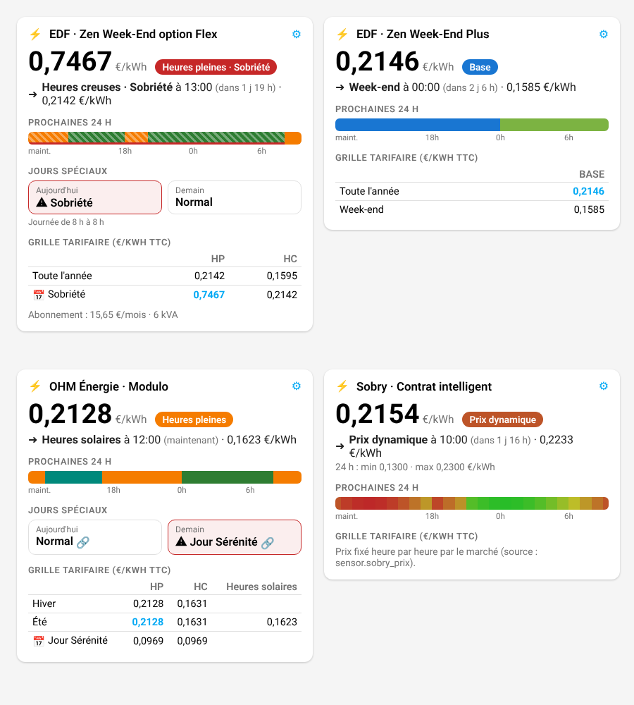
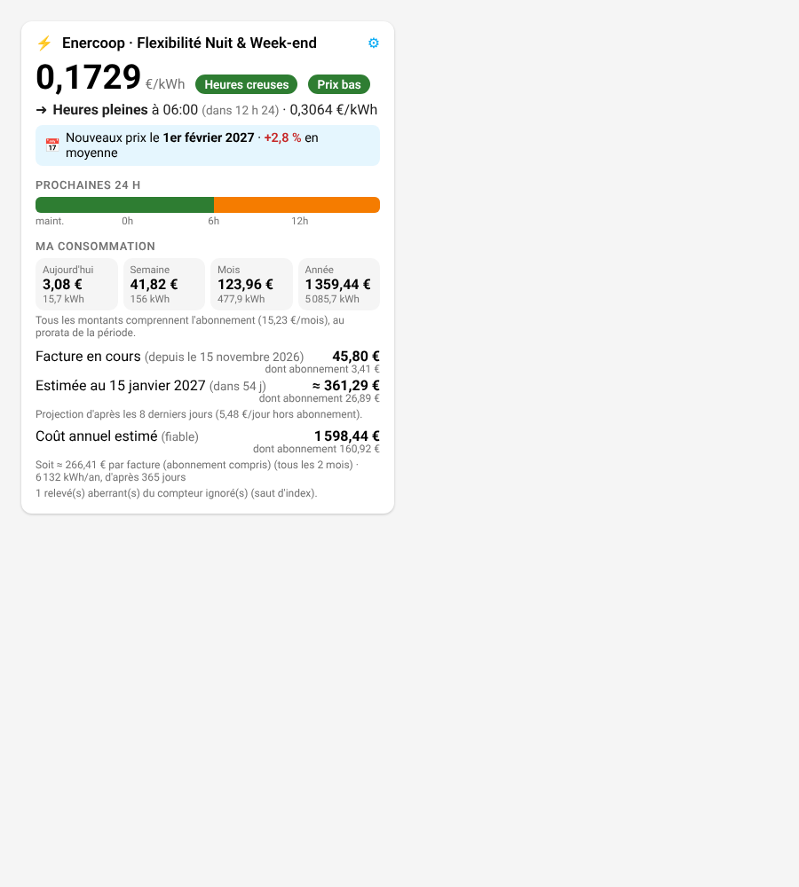

# Tarifs Électricité pour Home Assistant

[](https://hacs.xyz)
[](https://github.com/JVmaisGpeur/ha-tarifs-electricite/releases)
[](https://github.com/JVmaisGpeur/ha-tarifs-electricite/actions/workflows/validate.yml)
[](LICENSE)


Votre contrat d'électricité dans Home Assistant, **quel que soit le fournisseur**. Choisissez votre offre dans la liste (ou décrivez-la), recopiez les prix de votre facture : l'intégration calcule en continu le **prix du kWh en cours**, la **période** (heures pleines, creuses, super creuses, week-end…), les **jours spéciaux** (Tempo, Sobriété, Jour Éclair…) et les **prévisions de prix**. Tout est disponible en capteurs pour le tableau Énergie, les automatisations, les cartes et d'autres intégrations (batteries, recharge de voiture…).

Une carte Lovelace est incluse : elle s'installe toute seule avec l'intégration.





## Installation

Home Assistant 2025.1 ou plus récent (2026.3 ou plus pour voir l'icône de l'intégration).

[](https://my.home-assistant.io/redirect/hacs_repository/?owner=JVmaisGpeur&repository=ha-tarifs-electricite&category=integration)

1. Cliquez sur le bouton ci-dessus, ou : HACS → ⋮ → **Dépôts personnalisés** → `https://github.com/JVmaisGpeur/ha-tarifs-electricite`, type **Intégration**.
2. Télécharger **Tarifs Électricité**, puis redémarrer Home Assistant.
3. Paramètres → Appareils et services → **Ajouter une intégration** → *Tarifs Électricité* (ou [](https://my.home-assistant.io/redirect/config_flow_start/?domain=tarifs_electricite)).
4. Choisissez votre offre dans la liste, vérifiez la structure pré-remplie et saisissez vos prix.
5. Ajoutez la carte *Tarifs Électricité* à un tableau de bord.

Pour changer de prix ou d'offre plus tard : bouton **Configurer** de l'intégration, ou la roue dentée de la carte (voir ci-dessous).

## Ma consommation : coûts, mensualité, solde

Facultatif, à la fin de la configuration (ou plus tard : **Configurer → Suivi de consommation et mensualité**). Choisissez le **compteur d'énergie soutirée du réseau** — celui du tableau Énergie (Linky via TIC, Shelly EM, Enphase « consommation d'énergie nette cumulée »…). L'historique déjà enregistré par Home Assistant est utilisé immédiatement.

Puis indiquez comment vous payez :

- **Mensualités** (prélèvement fixe + régularisation) : montant de la mensualité, nombre de prélèvements par an, date de la dernière régularisation → mensualité conseillée, écart, solde.
- **Consommation réelle** (facture tous les 1, 2, 3, 6 ou 12 mois, sans mensualité) : fréquence et date d'une de vos factures pour caler les périodes → **facture en cours**, **montant estimé de la prochaine facture** et sa date (`sensor.tarif_electricite_facture_en_cours`, `_facture_estimee`, `_prochaine_facture`).

Dans les deux cas : `sensor.tarif_electricite_cout_annuel_estime`. Les **sauts aberrants du compteur** (passerelle qui redémarre et repasse un instant à 0, ce que Home Assistant prend pour des milliers de kWh consommés) sont détectés et corrigés : une heure ne peut dépasser la puissance souscrite + 25 %.

| Ce que vous obtenez | Comment c'est calculé |
|---|---|
| **Coût aujourd'hui, cette semaine, ce mois-ci, cette année** (`sensor.tarif_electricite_cout_*`) | consommation heure par heure × prix de cette heure-là (HP/HC, week-end, Tempo, jours spéciaux…), + la part d'abonnement. Attributs : kWh, coût énergie, coût abonnement, prix moyen payé |
| **Mensualité estimée** (`sensor.tarif_electricite_mensualite_estimee`) | votre consommation des 12 derniers mois, aux prix de votre grille la plus récente (évolution prévue comprise), + 12 mois d'abonnement, divisé par le nombre de prélèvements (10, 11 ou 12). Attributs : consommation annuelle, coût annuel, répartition HP/HC en %, **fiabilité** |
| **Écart avec la mensualité du fournisseur** (`sensor.tarif_electricite_ecart_mensualite`) | estimée − prélevée. Positif : régularisation à prévoir ; négatif : vous payez trop. Un conseil en clair est fourni (« vous pouvez demander à baisser votre mensualité d'environ 25 €/mois ») |
| **Solde depuis la dernière facture** (`sensor.tarif_electricite_solde_estime`) | mensualités payées (au prorata) − coût réellement consommé depuis la date de début de période. Positif : remboursement probable |

**Fiabilité de l'estimation** : *bonne* avec une année complète de données ; *moyenne* entre 3 et 11 mois, *faible* sous 3 mois (la consommation est extrapolée sur un an, sans tenir compte des saisons : chauffage, climatisation…) ; aucune estimation sous 14 jours.

Le prix des heures passées vient de l'historique du capteur *Prix actuel* (donc exactement ce qui était affiché, y compris prix dynamique et jours spéciaux). Pour les heures d'avant l'installation de l'intégration, il est recalculé avec les grilles saisies, l'historique des couleurs Tempo et le journal des jours spéciaux.

## Évolutions tarifaires et historique des prix

Quand votre fournisseur annonce de nouveaux prix (en général un mois avant), ouvrez **Configurer**, saisissez les nouveaux prix, puis choisissez :

- **Évolution tarifaire** + la date d'effet annoncée : l'intégration continue d'appliquer les prix actuels, puis **bascule toute seule à minuit le jour J**. La carte affiche « Nouveaux prix le 1er février 2027 · +2,8 % en moyenne » en attendant.
- **Correction** : pour rectifier une erreur de saisie, sans créer d'historique.

Chaque grille est conservée avec sa date d'effet. La carte montre l'historique (prix avant → après, en %, abonnement compris), et l'attribut `historique_prix` de `sensor.tarif_electricite_prix_actuel` le rend disponible pour vos propres cartes ou automatisations. Une évolution annulée ou saisie en double se retire avec **Configurer → Supprimer une grille**.

Les prévisions et le service `previsions` tiennent compte d'une évolution prévue : le créneau le moins cher calculé la veille d'une hausse utilise déjà les bons prix.

### Installation manuelle

Copiez le dossier `custom_components/tarifs_electricite` dans le dossier `custom_components` de votre configuration, puis redémarrez Home Assistant.

## Offres prêtes à l'emploi

Le modèle pré-remplit la **structure** de l'offre (plages connues, week-end, jours spéciaux, saisons). Les **prix ne sont jamais pré-remplis** : ils changent souvent, recopiez ceux de votre facture ou de la grille tarifaire du fournisseur. Vérifiez toujours la structure proposée.

| Modèle | Ce qui est pré-rempli |
|---|---|
| EDF Tempo | type Tempo, HC 22 h–6 h, couleurs automatiques |
| EDF Zen Week-End / Zen Week-End Plus | prix week-end et fériés (+ jour au choix en semaine pour Plus) |
| EDF Zen Week-End Heures Creuses | HP/HC + prix week-end |
| EDF Zen Week-End option Flex | HC 13 h–18 h et 20 h–8 h, jours **Sobriété** (journée de 8 h à 8 h) |
| Enercoop Flexibilité Nuit & Week-end | HC 23 h–6 h, week-end et fériés en HC |
| TotalEnergies Charge'Heures | HP/HC + heures super creuses à saisir |
| TotalEnergies Heures Eco+ | HP/HC + **Jours Éclair** |
| Octopus Go | HP/HC (heures creuses de nuit à saisir) |
| OHM Énergie Week-End / Modulo / Beaux Jours | week-end en HC / heures solaires + saisons + Jours Sérénité / Base avec prix d'été |
| Sobry, Frank Énergie | prix dynamique lu sur une autre entité |
| **Autre offre** | vous décrivez tout vous-même |

## Tout ce qu'on peut décrire

| Besoin | Où |
|---|---|
| Prix unique | type **Base** |
| Heures pleines / creuses, plusieurs plages (`02:00-07:00, 13:00-16:00`) | type **HP/HC** |
| Heures super creuses | HP/HC, champs facultatifs |
| Une période nommée en plus (« Heures solaires »…) | HP/HC, champs facultatifs |
| Week-end : comme en semaine, tout en HC, ou **prix week-end dédié** (avec ou sans prix HC week-end) | étape *Calendrier* |
| Jours fériés : comme en semaine, tout en HC, ou comme le week-end (calcul automatique, Alsace-Moselle en option) | étape *Calendrier* |
| Jours de semaine au tarif week-end (lundi, mercredi…) | étape *Calendrier* |
| Prix (et plages) différents hiver / été, mois au choix | étape *Calendrier* → *Été* |
| 1 ou 2 types de **jours spéciaux** (Sobriété, Éclair, Sérénité…), avec heure de début de journée | étape *Calendrier* → *Jours spéciaux* |
| Tempo | type **Tempo** : couleurs et prévisions sur 15 jours récupérées automatiquement ([calendrier-tempo.fr](https://www.calendrier-tempo.fr/domotique), sans compte) |
| Prix qui change chaque heure | type **Prix dynamique** : choisissez l'entité qui donne le prix (intégration Sobry, EPEX Spot, Nord Pool…). €/MWh et c€/kWh convertis automatiquement, majoration (taxes, acheminement) en option. Si l'entité publie les prix à venir, ils servent aux prévisions |

### Jours spéciaux : comment l'intégration sait que c'est un jour spécial ?

Les fournisseurs annoncent ces jours la veille (par mail, SMS ou dans leur appli), sans API publique. Deux façons de faire :

- **D'un appui** : sur la carte, touchez *Aujourd'hui* ou *Demain* pour passer de « Normal » à « Sobriété ». Ce sont aussi des entités `select.tarif_electricite_jour_special_aujourdhui` / `_demain`, réglables par une automatisation. À l'heure de début de journée, « demain » devient « aujourd'hui ».
- **Automatiquement** : si une autre intégration annonce déjà ces jours (ex. l'intégration EDF Zen Flex), choisissez son entité comme source et indiquez l'état qui signifie « jour spécial » (ex. `Sobriété` ; majuscules et accents ignorés). La carte affiche alors 🔗.

## Entités créées

Identifiants identiques sur toutes les installations :

| Entité | Contenu |
|---|---|
| `sensor.tarif_electricite_prix_actuel` | Prix du kWh en ce moment (EUR/kWh). Attributs : période, libellé, jour spécial, prochain changement, min/max sur 24 h, grille, `previsions` (tranches des 48 h à venir) |
| `sensor.tarif_electricite_periode` | `hp`, `hc`, `hsc` (super creuses), `perso` (période nommée), `we`, `we_hc` (week-end), `base` ou `dyn` (prix dynamique) |
| `sensor.tarif_electricite_prochain_changement` / `_prochain_prix` | quand le prix change, et le prix suivant |
| `binary_sensor.tarif_electricite_heures_creuses` | `on` en heures creuses, super creuses, période nommée et week-end creuses |
| `binary_sensor.tarif_electricite_heures_super_creuses` | si l'offre en a |
| `binary_sensor.tarif_electricite_prix_bas` | `on` quand le prix est dans le tiers le moins cher des 24 h à venir — **marche avec toutes les offres**, y compris le prix dynamique |
| `binary_sensor.tarif_electricite_jour_special` | `on` pendant un jour spécial |
| `select.tarif_electricite_jour_special_aujourdhui` / `_demain` | type de jour (offres à jours spéciaux) |
| `sensor.tarif_electricite_abonnement_mensuel` | si renseigné |
| `sensor.tarif_electricite_tempo_aujourdhui` / `_demain` / `_previsions` | offres Tempo |

**Tableau Énergie** : Paramètres → Tableaux de bord → Énergie → consommation réseau → *Utiliser une entité avec le prix actuel* → `sensor.tarif_electricite_prix_actuel`.

## Service `tarifs_electricite.previsions`

Renvoie les tranches de prix à venir, la moins chère, la plus chère et, si `duree` est donnée, **le créneau continu le moins cher** de cette durée.

```yaml
action: tarifs_electricite.previsions
data:
  heures: 24
  duree: 3
response_variable: tarifs
# tarifs.meilleur_creneau → {debut, fin, prix_moyen}
```

## Exemples d'automatisations

Charger une batterie quand le prix est bas (toutes offres) :

```yaml
alias: Batteries – charge quand le prix est bas
triggers:
  - trigger: state
    entity_id: binary_sensor.tarif_electricite_prix_bas
    to: "on"
actions:
  - action: select.select_option
    target:
      entity_id: select.zendure_mode   # adaptez à votre entité
    data:
      option: Puissance manuelle
```

Planifier une charge de 3 h au moment le moins cher des 24 prochaines heures :

```yaml
alias: Batteries – planifier la charge la moins chère
triggers:
  - trigger: time
    at: "18:00:00"
actions:
  - action: tarifs_electricite.previsions
    data: { heures: 24, duree: 3 }
    response_variable: tarifs
  - action: input_datetime.set_datetime
    target: { entity_id: input_datetime.debut_charge_batteries }
    data:
      datetime: "{{ tarifs.meilleur_creneau.debut }}"
```

Être prévenu d'un jour spécial demain :

```yaml
triggers:
  - trigger: state
    entity_id: select.tarif_electricite_jour_special_demain
condition: "{{ trigger.to_state.state != 'Normal' }}"
actions:
  - action: notify.notify
    data:
      message: "Demain : {{ trigger.to_state.state }}. Pensez à décaler vos consommations."
```

## Carte

```yaml
type: custom:tarifs-electricite-card
entity: sensor.tarif_electricite_prix_actuel
heures: 24            # 12, 24 ou 48
# Sections facultatives, masquées par défaut : activez celles que vous voulez
afficher_frise: true
afficher_tempo: true
afficher_grille: true
afficher_historique: true
afficher_suivi: true
# titre: Mon contrat
```

Toutes les sections sont masquées par défaut : la carte n'affiche que le prix, la période et le prochain changement tant que vous n'activez rien (éditeur visuel de la carte).

Prix en cours, période, badge « Prix bas », prochain changement, frise colorée des prochaines heures (dégradé vert → rouge pour le prix dynamique, hachures pour les jours spéciaux), jours spéciaux d'aujourd'hui et de demain (modifiables d'un appui), couleurs Tempo, grille de prix. Un appui sur le prix ouvre l'historique ; la roue dentée ouvre la configuration.

## Tests

Aucune dépendance à installer :

```bash
python3 tests/test_tariff.py        # moteur de calcul
python3 tests/test_suivi.py         # coûts, mensualité, solde
python3 tests/test_gestionnaire.py  # jours spéciaux, sources, prix dynamique, évolutions datées, suivi (HA simulé)
python3 tests/test_config_flow.py   # tous les écrans de configuration (HA simulé)
```

## Contribuer

Bugs, idées, offres de fournisseurs à ajouter aux modèles : [ouvrez une issue](https://github.com/JVmaisGpeur/ha-tarifs-electricite/issues). Pour une offre, indiquez le fournisseur, le nom de l'offre et un lien vers sa grille tarifaire.

Cette intégration n'est affiliée à aucun fournisseur d'électricité. Les noms d'offres ne servent qu'à pré-remplir la structure ; vérifiez toujours les plages et les prix sur votre contrat.

## Licence

MIT – JVmaisGpeur
